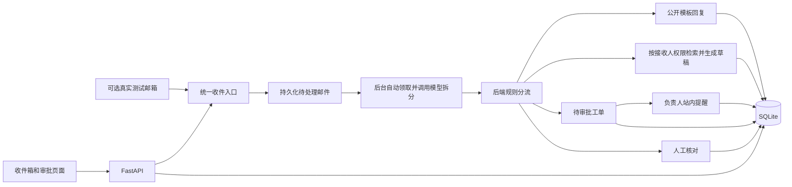

# InboxFlow — An AI Agent for Enterprise Email Triage and Approval

SC6105 小组项目实施方案 · 五人团队 · 第 1–12 教学周

## 1. 产品目标与首版范围

企业共享邮箱里，一封来信可能同时包含咨询和需要授权的业务请求。经办人需要知道哪些问题已经答复、哪些事项仍等财务确认，以及回复依据哪一版制度。InboxFlow 把每项请求与原文、处理人、回复或审批决定关联起来，让团队在同一邮件线程内完成处理和复核。

**验收场景**：供应商来信询问发票提交地址，并申请变更收款账户。邮件进入收件箱后自动开始处理。系统对第一项发出已批准的公开模板，对第二项创建待核验工单，并向负责该工单的财务审批人发送站内提醒。经办人此时看到「已处理 1/2」。审批人批准或驳回并填写理由后，原线程显示两项结果和操作时间。另一封员工来信触发带制度出处的回复草稿，经办人确认后发出站内回复。

| 首版能力 | 实现范围 |
|---|---|
| 模拟邮箱 | 载入样例或手动输入纯文本，选择预设发件人，查看收件箱、线程和处理进度 |
| AI 分流 | 一封邮件可产生多项请求，每项保留原文片段、类型和可选业务字段 |
| 回复与检索 | 两个公开模板，五份短制度文档，按接收人可见范围检索，草稿可编辑 |
| 审批 | 采购、付款及收款账户变更均创建站内工单，记录模拟业务决定；金额和账户仅使用虚构数据 |
| 运行环境 | 一台演示机、一个后端、一个 SQLite 文件和一个模型接口。开发末期可试接一个真实测试邮箱收取纯文本来信。附件解析及财务系统对接列入后续版本 |

## 2. 处理流程与决策规则

1. 样例导入、手动录入和可选的邮箱同步共用一个收件入口。后端保存邮件时将其标记为待处理，默认自动入队。发件人的资料权限按通讯录映射，未知地址按外部身份处理。
2. 后台任务领取待处理邮件，将主题、正文交给模型拆分请求。收件人可以离开页面；重新打开线程即可查看结果。「重试」供处理失败后恢复使用。校验结构、枚举值和原文片段，保存首次有效的拆分结果。空结果、解析失败或可能遗漏敏感事项时，保留原邮件并提示经办人核对。
3. 后端按下表处理各子任务。遇到无法对应子任务的采购、付款或账户变更措辞时，增加待核对事项。经办人可以补录漏拆的请求，并留下修订记录。
4. 线程分别显示对外的站内回复和内部处理记录。审批理由仅出现在内部视图。每次生成回复、发送草稿或作出审批决定后，重新计算整封邮件的进度。

| 请求类型 | 处理动作 | 完成条件 |
|---|---|---|
| 公开咨询 | 后端只允许已登记的主题使用对应模板，如发票提交方式、办公时间。模板只回答这一项 | 站内回复已写入线程 |
| 内部政策 | 检索接收人可见的制度段落，生成附章节号的草稿；证据不足时标为待核对 | 经办人确认回复并发送，或人工记录处理结果 |
| 采购或付款类 | 根据子类型建采购、付款或账户变更核验工单，分派负责人并提醒；缺少金额、申请人等信息时按子类型提示补充 | 审批人给出批准或驳回结论；站内结案仅代表完成模拟审批 |
| 无法判断 | 展示请求原文，由经办人补充、重新分流或人工答复 | 留下处理结果；转入审批类的继续走审批流程 |

**权限模型。** 两个操作角色为经办人和审批人。演示可设「供应商、内部经办人、内部审批人」三个模拟身份，内部经办人也可作为员工来信的发件人。由后端会话确定当前操作者，通讯录确定回复接收人的资料权限。模型只能建议类型和提取字段。审批接口验证操作者为该工单的指定审批人，且工单仍为待审批。

**分派与提醒。** 后端按配置将采购请求分派给采购负责人，付款和账户变更分派给财务负责人。两者均使用审批人角色，演示时可由同一模拟账号兼任。未配置负责人时，工单进入经办人的待分派队列并提醒值班经办人。分派成功后，负责人在「我的提醒」看到未读数量，点开可直达工单。阅读提醒只更新已读状态。

## 3. 技术架构与接口约定

前端采用 React + Vite，后端采用 FastAPI + SQLite。浏览器只访问后端。模型密钥由后端环境变量读取。建议在 `src/frontend/` 和 `src/backend/` 开发，评测样例与自动化测试放在 `tests/`。一人维护同一模块的页面、接口或测试，减少跨成员等待。



**模型输出样例。** 以下为前后端联调使用的固定示例。后端根据两个原文片段分别决定动作，并从自己的模板库读取回复文本。

```json
{
  "requests": [
    {"type": "public_query", "topic": "invoice_submission", "source_text": "发票交到哪里", "fields": {}},
    {"type": "approval", "topic": "bank_account_change", "source_text": "能否换收款账户", "fields": {}}
  ]
}
```

**核心数据。** 邮件保存来源邮箱、来源消息 ID、正文、发件人、处理批次及处理状态。请求子任务保存邮件 ID、原文、类型、状态及等待原因。回复保存子任务 ID、接收人、草稿或已发送状态、模板或制度章节。审批工单保存子任务 ID、负责人、待审批或终态、实际审批人、理由和时间。提醒保存工单 ID、接收人、事件、创建及已读时间。另设模拟身份、知识库章节及操作日志，以支持权限过滤和审计。

| 接口 | 作用与约束 |
|---|---|
| `POST /emails`、`GET /emails`、`GET /emails/{id}` | 录入即自动排队，或列出、读取邮件及关联记录 |
| `POST /emails/{id}/process` | 手动重试失败的任务，复用自动处理入口；已有结果或正在处理时返回当前进度 |
| `POST /tasks/{id}/review`、`POST /emails/{id}/tasks` | 经办人核对、修订或补录请求，记录原因，重新应用分流规则 |
| `POST /tasks/{id}/draft`、`POST /tasks/{id}/send` | 生成或编辑草稿，经办人确认发送；按接收人权限检查引用 |
| `GET /approvals`、`POST /approvals/{id}/decision` | 读取队列，指定审批人对待审批工单提交决定和理由 |
| `GET /notifications`、`POST /notifications/{id}/read` | 按登录身份列出自己的提醒并标记已读；前端定时刷新 |
| `POST /approvals/{id}/assign` | 经办人将待分派工单指派给审批角色，写入负责人和提醒 |

**状态与重试。** 子任务使用「待处理、待人工、已完成、已驳回」，待人工另存原因，如待发送、待审批或待核对。所有子任务均进入终态且拆分已完成，邮件方可结案；拆分失败的邮件进入人工队列。后端先保存拆分结果，再按持久化的子任务 ID 处理尚未完成的动作。后台启动或重启时扫描待处理记录。建单、分派和写入提醒在同一事务内完成；按工单、接收人和分派事件去重，重复处理只展示已有提醒。每个审批类子任务最多一张工单，每个子任务的首次业务答复最多发送一次。用数据库唯一约束和短事务保护写入，审批采用「当前为待审批」的条件更新。模型调用设超时，放在写事务之外；处理进程中断时允许超时后的重新领取。

**知识库。** 五份虚构资料可选发票指南、办公时间、差旅报销、采购制度、付款及账户变更流程。每段带文档 ID、章节号、版本和可见范围。先按接收人过滤，再用关键词和少量同义词检索最相关片段。仅知识问答需要第二次模型调用；后端核验返回的章节号属于本次检索结果，经办人可点开原文核对内容。没有可见依据时保留人工待办。

**真实邮箱试接（第 9 周末提交后可选）。** A、C 使用已授权的专用测试邮箱，以只读方式轮询一个测试文件夹，将纯文本来信转为与模拟邮件一致的输入。用邮箱标识和服务端稳定消息 ID 去重，整批写入成功后才推进同步位置。凭据由本机环境提供。试接以一封测试来信能自动产生回复记录、工单和站内提醒为验收目标，回复展示在 InboxFlow 线程中。账号或连接不可用时，记录试接结果，用模拟入口完成演示。

## 4. 五人分工

A–E 为待认领的五个席位。每人负责一个模块，并承担相应的需求分析、实现、测试和汇报。团队在第 2、5 周交付时按实际可用时间调整工作量。集成或文档任务集中在一人身上时，由已完成本模块的成员结对分担。

| 成员 | 第 1–2 周 · 提案 | 第 3–5 周 · SRS | 第 6–9 周 · 设计、实现与测试 | 第 10–12 周 · 展示 |
|---|---|---|---|---|
| A · 邮箱与线程 | 整理共享邮箱的用户和使用场景 | 收件箱、邮件详情、提醒入口的 UI 草图及界面交互流程图 | 实现线程和处理进度，测试刷新与重试后的显示 | 录制主流程，演示来信与回复 |
| B · 审批与权限 | 定义工单范围和审批角色 | 分派规则、审批用例和活动图 | 实现工单、负责人提醒和权限检查，测试批准与驳回 | 演示负责人收到提醒并完成审批 |
| C · 邮件工作流 | 拟定初步架构、里程碑和任务依赖 | 数据字典、概念类图和邮件状态定义 | 搭建应用骨架，打通收件、状态汇总和去重，整理系统架构 | 准备可重复启动的演示环境，讲解架构 |
| D · 邮件 Agent | 说明模型用途、成本与可行性 | 定义四类路由、模型失败回退和拆分用例 | 实现模型拆分与公开模板分流，评测漏拆、错分 | 用混合邮件解释自动处理规则 |
| E · 知识库与评测 | 估算资料整理与评测所需资源 | 定义引用、可见范围、非功能需求和验收样例 | 实现检索与草稿，搭建测试框架，汇总各模块回归结果 | 展示带出处的草稿和测试结果 |

五人共同确认提案目标，各自提供一页 CV、模块测试用例和每次提交的个人贡献说明。组长由成员推选，负责汇总与提交。各模块负责人绘制对应的顺序图并参与设计文档复核。

## 5. 按课程周推进

正式截止时间采用 [Homework.pdf 的 Roadmap](proposal/Homework.pdf) 中的教学周。下表的中间步骤是团队建议安排，具体工作日可随课表调整。

| 教学周 | 当期工作 | 阶段产出 |
|---|---|---|
| 第 1–2 周 | 确认五位成员、组长和队名。用一封混合邮件说明业务问题，讨论用户、范围、初步技术方案、预算和任务依赖。第 2 周留时间合稿 | **第 2 周末提交团队信息、Project Proposal 和五人 CV** |
| 第 3–4 周 | 从供应商和员工来信写用例。先画收件箱和审批页面，再用样例逐步推演自动回复、负责人提醒、人工审批和制度草稿 | SRS 草案、UI 草图、需求模型、标注样例及预期结果 |
| 第 5 周 | 走查「一项已回复、一项待审批」及驳回、重试等路径。检查每项需求是否能通过页面、状态或测试结果验证，留出修改时间 | **第 5 周末提交 SRS**，含功能和非功能需求、数据字典、UI 草图、用例模型、概念类图、顺序图、界面交互流程图和活动图 |
| 第 6 周 | 依据 SRS 细化类图、顺序图、界面流转及接口。建立前后端骨架、数据库和测试入口，先用固定拆分结果完成一次联调 | 模拟邮件可入库，线程能展示子任务，测试框架可运行首个用例 |
| 第 7 周 | 接入自动处理、模型拆分、模板回复、工单分派与提醒。五人沿同一封混合邮件联调 | 经办人看到 1/2 进度，负责人从提醒进入工单；审批后线程显示完整记录 |
| 第 8 周 | 接入制度检索、引用草稿及人工回退。用标注集和保留集验证路由、权限、重试与结案 | 员工来信能生成带出处的草稿；记录每项失败的输入、预期和实际结果 |
| 第 9 周 | 以修复、回归和文档复核为主。由另一位成员从干净数据库启动应用，对照设计图复跑两封演示邮件 | **第 9 周末提交设计与测试文档**，含完整类图、顺序图、界面交互流程图、系统架构、应用骨架和测试框架 |
| 第 10 周 | 用已验证的模拟邮箱流程制作 PPT，录制并复看视频。材料就绪且有余量、测试账号时，A、C 可试接真实邮箱 | **第 10 周末提交 PPT 和 MP4 演示视频** |
| 第 11–12 周 | 按课程分配的展示场次合练角色切换、原型操作和问答，使用已验证的演示版本 | **项目汇报与原型演示** |

第 7 周联调若需更多时间，可占用第 8 周先补齐自动处理与审批流程；知识库草稿先支持从一份制度检索并展示引用，再逐步扩展。第 9 周预留给回归和文档整理，第 10 周优先保障录制与提交。固定模型输出可供联调和离线演示，界面标明使用「实时模型」或「固定样例」。

## 6. 评测与现场演示

准备 20 封带预期结果的模拟邮件，可按主要场景分配为公开咨询 4 封、内部制度 4 封、采购付款 4 封、混合请求 5 封、未知或缺少证据 3 封。抽出覆盖上述五类的 5 封作保留集，其余 15 封用于开发。每封标注发件人、请求原文、预期路由、可引用章节、预期回复和工单数。分别报告两个集合的正确数及分母。拆分看是否遗漏请求，路由按请求评分，引用由另一位成员核对原文是否支持答案。

| 验收用例 | 可观察的通过条件 |
|---|---|
| 混合邮件 | 首次处理得到 2 个子任务、1 条公开答复、1 张待审批工单；审批前显示 1/2 |
| 自动处理与提醒 | 录入邮件后离开收件箱，后台仍完成分流。指定审批人收到一条未读提醒，打开后可见对应工单；其他账号看不到该提醒，标记已读后工单仍待审批 |
| 真实邮箱试接（可选） | 测试来信自动进入同一流程；重复轮询后仅有一封邮件、一张对应工单、一条分派提醒 |
| 批准与驳回 | 分别用两封独立样例触发两个结果，审批理由和操作者可追溯，原邮件在全部任务终结后结案 |
| 权限与知识库 | 经办人直接调用审批接口被拒绝；供应商检索结果和回复均不含员工专属章节 |
| 草稿与证据不足 | 有依据时能定位到对应版本及章节；草稿确认前没有已发送记录。无依据时出现待核对任务 |
| 重试与故障 | 同封邮件重复处理、同一按钮连点和模型超时后重试，均保持业务回复及工单数量正确 |
| 漏拆与未知请求 | 经办人可从原邮件补录漏项，未知事项进入人工队列，空拆分结果不会自动结案 |

**演示顺序（约 4 分钟）。** 第一位演示者录入混合邮件，展示两个子任务及 1/2 进度；第二位用负责人身份从未读提醒打开工单、填写理由并返回线程。随后录入员工制度咨询，打开引用原文、编辑草稿并确认发送。最后重试第一封邮件，核对回复与工单数量。

**已验证的设计假设。** 编写本方案时，用 Python 和内存 SQLite 对固定的双请求数据做了顺序实验。批准和驳回两条路径均从部分完成进入结案，经办人审批被拒绝，重复处理后仍为两个任务、一条回复和一张工单；模拟外部接收人只能检索公开章节。该实验覆盖状态规则和可见性过滤。后台自动领取、负责人提醒、真实模型拆分质量、并发与故障恢复、浏览器流程分别在第 6–9 周联调及回归时验证；真实邮箱按第 10 周的可选安排单独记录试接结果。

## 7. 提交材料存放

第 2 周的提案放在 `proposal/`，团队信息、CV 和个人贡献记录归入 `team/`。第 5 周的需求文档及模型放在 `srs/`。第 9 周的设计、应用骨架和测试材料分别归入 `design/`、`src/` 和 `tests/`。第 10 周的 PPT 和 MP4 放在 `presentation/`。每次正式提交均附本阶段各成员的贡献说明，可引用对应需求、图表、提交或验收记录。
