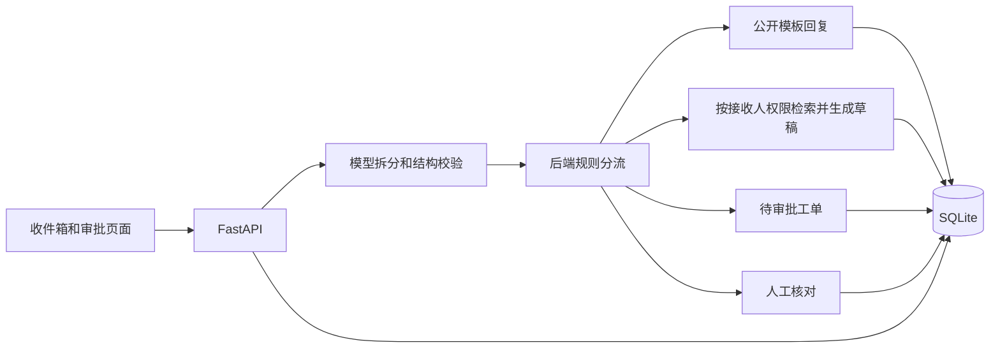

# InboxFlow — An AI Agent for Enterprise Email Triage and Approval

SC6105 小组项目实施方案 · 五人 · 十个开发日

## 1. 产品目标与首版范围

企业共享邮箱里，一封来信可能同时包含咨询和需要授权的业务请求。经办人需要知道哪些问题已经答复、哪些事项仍等财务确认，以及回复依据哪一版制度。InboxFlow 把每项请求与原文、处理人、回复或审批决定关联起来，让团队在同一邮件线程内完成处理和复核。

**验收场景**：供应商来信询问发票提交地址，并申请变更收款账户。系统对第一项发出已批准的公开模板，对第二项创建待核验工单。经办人此时看到「已处理 1/2」。审批人批准或驳回并填写理由后，原线程显示两项结果和操作时间。另一封员工来信触发带制度出处的回复草稿，经办人确认后发出站内回复。

| 首版能力 | 实现范围 |
|---|---|
| 模拟邮箱 | 载入样例或手动输入纯文本，选择预设发件人，查看收件箱、线程和处理进度 |
| AI 分流 | 一封邮件可产生多项请求，每项保留原文片段、类型和可选业务字段 |
| 回复与检索 | 两个公开模板，五份短制度文档，按接收人可见范围检索，草稿可编辑 |
| 审批 | 采购、付款及收款账户变更均创建站内工单，记录模拟业务决定；金额和账户仅使用虚构数据 |
| 运行环境 | 一台演示机、一个后端、一个 SQLite 文件和一个模型接口。真实邮箱、附件解析及财务系统对接列入后续版本 |

## 2. 处理流程与决策规则

1. 经办人录入邮件，后端生成邮件 ID，并从模拟通讯录读取发件人身份。回复默认发回该身份。
2. 点击「处理」后，后端将主题、正文交给模型拆分请求。校验结构、枚举值和原文片段，保存首次有效的拆分结果。空结果、解析失败或可能遗漏敏感事项时，保留原邮件并提示经办人核对。
3. 后端按下表处理各子任务。遇到无法对应子任务的采购、付款或账户变更措辞时，增加待核对事项。经办人可以补录漏拆的请求，并留下修订记录。
4. 线程分别显示对外的站内回复和内部处理记录。审批理由仅出现在内部视图。每次生成回复、发送草稿或作出审批决定后，重新计算整封邮件的进度。

| 请求类型 | 处理动作 | 完成条件 |
|---|---|---|
| 公开咨询 | 后端只允许已登记的主题使用对应模板，如发票提交方式、办公时间。模板只回答这一项 | 站内回复已写入线程 |
| 内部政策 | 检索接收人可见的制度段落，生成附章节号的草稿；证据不足时标为待核对 | 经办人确认回复并发送，或人工记录处理结果 |
| 采购或付款类 | 根据子类型建采购、付款或账户变更核验工单；缺少金额、申请人等信息时按子类型提示补充 | 审批人给出批准或驳回结论；站内结案仅代表完成模拟审批 |
| 无法判断 | 展示请求原文，由经办人补充、重新分流或人工答复 | 留下处理结果；转入审批类的继续走审批流程 |

**权限模型。** 两个操作角色为经办人和审批人。演示可设「供应商、内部经办人、内部审批人」三个模拟身份，内部经办人也可作为员工来信的发件人。由后端会话确定当前操作者，通讯录确定回复接收人的资料权限。模型只能建议类型和提取字段。审批接口单独验证操作者角色和工单状态。

## 3. 技术架构与接口约定

前端采用 React + Vite，后端采用 FastAPI + SQLite。浏览器只访问后端。模型密钥由后端环境变量读取。建议在 `src/frontend/` 和 `src/backend/` 开发，评测样例与自动化测试放在 `tests/`。一人维护同一模块的页面、接口或测试，减少跨成员等待。



**模型输出样例。** 以下为前后端联调使用的固定示例。后端根据两个原文片段分别决定动作，并从自己的模板库读取回复文本。

```json
{
  "requests": [
    {"type": "public_query", "topic": "invoice_submission", "source_text": "发票交到哪里", "fields": {}},
    {"type": "approval", "topic": "bank_account_change", "source_text": "能否换收款账户", "fields": {}}
  ]
}
```

**核心数据。** 邮件保存正文、发件人、处理批次及处理状态。请求子任务保存邮件 ID、原文、类型、状态及等待原因。回复保存子任务 ID、接收人、草稿或已发送状态、模板或制度章节。审批工单保存子任务 ID、待审批或终态、审批人、理由和时间。另设模拟身份、知识库章节及操作日志，以支持权限过滤和审计。

| 接口 | 作用与约束 |
|---|---|
| `POST /emails`、`GET /emails`、`GET /emails/{id}` | 录入、列出、读取邮件及关联记录 |
| `POST /emails/{id}/process` | 原子领取处理权；已完成拆分则返回现有结果，正在处理则返回当前进度 |
| `POST /tasks/{id}/review`、`POST /emails/{id}/tasks` | 经办人核对、修订或补录请求，记录原因，重新应用分流规则 |
| `POST /tasks/{id}/draft`、`POST /tasks/{id}/send` | 生成或编辑草稿，经办人确认发送；按接收人权限检查引用 |
| `GET /approvals`、`POST /approvals/{id}/decision` | 读取队列，审批人对待审批工单提交决定和理由 |

**状态与重试。** 子任务使用「待处理、待人工、已完成、已驳回」，待人工另存原因，如待发送、待审批或待核对。所有子任务均进入终态且拆分已完成，邮件方可结案；拆分失败的邮件进入人工队列。后端先保存拆分结果，再按持久化的子任务 ID 处理尚未完成的动作。每个审批类子任务最多一张工单，每个子任务的首次业务答复最多发送一次。用数据库唯一约束和短事务保护写入，审批采用「当前为待审批」的条件更新。模型调用设超时，放在写事务之外；处理进程中断时允许超时后的重新领取。

**知识库。** 五份虚构资料可选发票指南、办公时间、差旅报销、采购制度、付款及账户变更流程。每段带文档 ID、章节号、版本和可见范围。先按接收人过滤，再用关键词和少量同义词检索最相关片段。仅知识问答需要第二次模型调用；后端核验返回的章节号属于本次检索结果，经办人可点开原文核对内容。没有可见依据时保留人工待办。

## 4. 五人分工与工时

按每人每天约 3 小时估算，共约 150 人时。A–E 为待认领席位。每人约 30 小时，包含实现、测试、集成和课程材料。每项功能由同一负责人演示并说明验收结果。

| 成员 | 交付与工时 | 协作与验收责任 |
|---|---|---|
| A · 邮箱与线程 | 收件箱、录入、邮件详情和进度 16h；对接与页面测试 8h；UI 草图及演示录屏 6h | 和 C 对齐详情接口，验证刷新后任务和回复仍可见 |
| B · 审批与权限 | 工单接口、角色检查与决定写入 13h；审批队列及详情页 9h；权限测试与顺序图 8h | 和 C 对齐事务边界，演示越权拒绝、批准、驳回和重复点击 |
| C · 邮件工作流 | 数据模型、迁移及基础接口 12h；状态汇总、重试和动作去重 12h；集成测试与架构图 6h | 负责主流程，D 交付拆分结果，B/E 交付审批及草稿结果 |
| D · 邮件 Agent | 模型适配、结构校验与人工回退 14h；分流、公开模板和漏拆核对 9h；样例标注、评测及用例图 7h | 第一天提供固定输出，验证相同意图换种说法仍能正确分流 |
| E · 知识库与评测 | 制度资料、可见范围和检索 12h；引用草稿接口及编辑确认视图 10h；盲测、结果汇总和演示脚本 8h | 与 A 对接线程内的草稿组件，联合 D 检查引用是否支持回答 |

## 5. 十天实施顺序

| 日期 | 当天要完成的工作 | 可以现场检查的结果 |
|---|---|---|
| D1 | 五人确认类型、权限、子任务终态和接口样例。D 实测模型账户。D、E 准备标注格式，预留盲测邮件 | 全员可读同一份混合邮件样例；一次实际模型调用返回可校验的请求数组 |
| D2 | A 做线程页，B 做审批队列，C 接数据库和固定拆分结果，D/E 准备模板及制度 | 固定输入可生成两个子任务，从线程进入审批，再回到原邮件看结果 |
| D3 | D 接真实拆分，C 保存拆分结果，B 加角色验证，A 接录入，E 接可见范围过滤 | 新录入邮件能持久化，员工和供应商得到不同的可检索章节 |
| D4 | 接模板自动回复、账户变更工单、人工待办和操作日志 | 常规、审批、未知三种邮件各跑通一次 |
| D5 | 合并主流程，五人共同跑混合邮件 | 新邮件经真实模型拆出两项，自动回复一项、审批另一项；刷新仍能看到完整记录 |
| D6 | 接通制度草稿、章节引用、编辑发送及证据不足回退 | 员工来信能从草稿打开原文，确认后线程出现回复 |
| D7 | 处理模型超时、重复处理、审批重入和人工补录 | 重试后回复数、工单数正确；被驳回的请求有可查理由 |
| D8 | 运行标注集和保留样例，记录每例预期、实际、差异及负责人 | 列出漏拆、错分、错误引用和状态错误，可复现失败案例 |
| D9 | 修复失败项，重跑回归，另一位成员按启动说明从干净数据库启动 | 可以一键或一步载入演示数据；在另一台开发机完成一次全流程 |
| D10 | 按脚本演示、录制 MP4，整理 SRS 和设计测试文档所需材料及个人贡献 | 能从新录入邮件一直追踪至结案，评测结果随演示版本归档 |

若 D5 未达到混合邮件验收条件，D6 先让知识库返回带章节号的原文片段，由经办人编辑成草稿；A、B、C 集中修复主流程。固定模型输出可供联调和离线演示，演示界面标明当前使用「实时模型」或「固定样例」。

## 6. 评测与现场演示

准备 20 封带预期结果的模拟邮件，可按主要场景分配为公开咨询 4 封、内部制度 4 封、采购付款 4 封、混合请求 5 封、未知或缺少证据 3 封。抽出覆盖上述五类的 5 封作保留集，其余 15 封用于开发。每封标注发件人、请求原文、预期路由、可引用章节、预期回复和工单数。分别报告两个集合的正确数及分母。拆分看是否遗漏请求，路由按请求评分，引用由另一位成员核对原文是否支持答案。

| 验收用例 | 可观察的通过条件 |
|---|---|
| 混合邮件 | 首次处理得到 2 个子任务、1 条公开答复、1 张待审批工单；审批前显示 1/2 |
| 批准与驳回 | 分别用两封独立样例触发两个结果，审批理由和操作者可追溯，原邮件在全部任务终结后结案 |
| 权限与知识库 | 经办人直接调用审批接口被拒绝；供应商检索结果和回复均不含员工专属章节 |
| 草稿与证据不足 | 有依据时能定位到对应版本及章节；草稿确认前没有已发送记录。无依据时出现待核对任务 |
| 重试与故障 | 同封邮件重复处理、同一按钮连点和模型超时后重试，均保持业务回复及工单数量正确 |
| 漏拆与未知请求 | 经办人可从原邮件补录漏项，未知事项进入人工队列，空拆分结果不会自动结案 |

**演示顺序（约 4 分钟）。** 第一位演示者录入混合邮件，展示两个子任务及 1/2 进度；第二位用审批身份查看工单、填写理由并返回线程。随后录入员工制度咨询，打开引用原文、编辑草稿并确认发送。最后重试第一封邮件，核对回复与工单数量。

**已验证的设计假设。** 编写本方案时，用 Python 和内存 SQLite 对固定的双请求数据做了顺序实验。批准和驳回两条路径均从部分完成进入结案，经办人审批被拒绝，重复处理后仍为两个任务、一条回复和一张工单；模拟外部接收人只能检索公开章节。该实验覆盖状态规则和可见性过滤。真实模型拆分质量、并发请求、故障恢复、浏览器页面以及端到端耗时留待 D1–D9 验证。

## 7. 对应 SC6105 交付

| 课程节点 | 本项目可以交付的材料 |
|---|---|
| 第 2 周末 · 提案 | 业务问题、范围、用户、技术方案、预算、成员分工、里程碑及依赖甘特图；附团队信息、个人贡献和每人一页 CV |
| 第 5 周末 · SRS | 按上述验收项编号功能与非功能需求；数据字典、用例模型、UI 草图、概念类图、顺序图、界面交互流程图和活动图 |
| 第 9 周末 · 设计与测试 | 完整类图、顺序图、界面交互流程图、系统架构、应用骨架、测试框架及设计测试文档 |
| 第 10 周末及第 11–12 周 | 提交 PPT 和 MP4，安排项目汇报和原型演示 |

十天为组内原型开发周期；正式提交按课程周次进行。每次提交均附个人贡献。开发期间每位成员记录功能、对应需求、提交或 PR、验收证据及协作者，方便整理课程材料。课程原始清单见[项目作业说明](proposal/Homework.pdf)。
